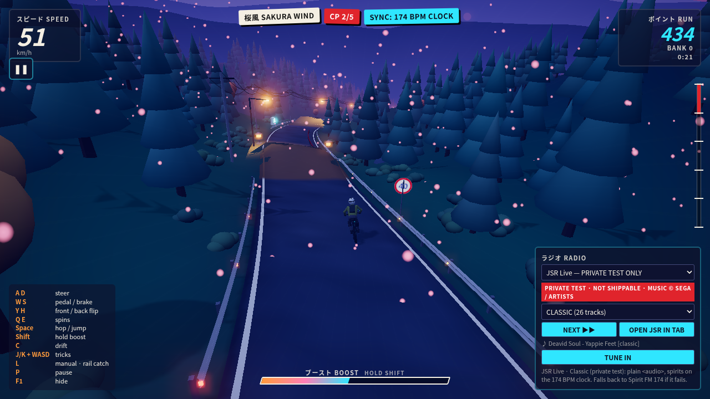
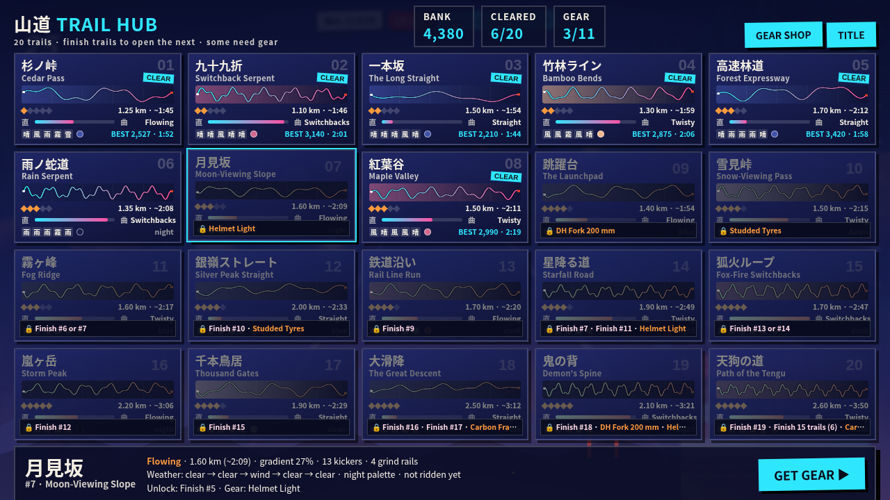
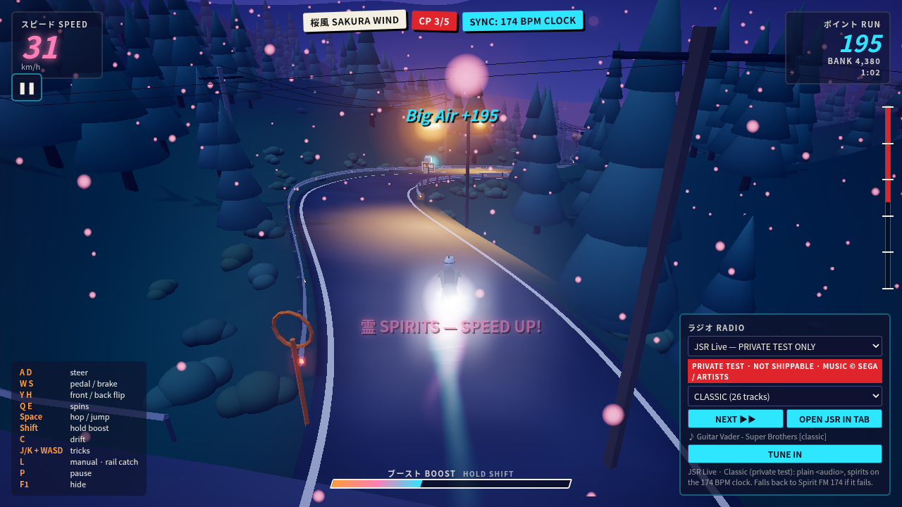
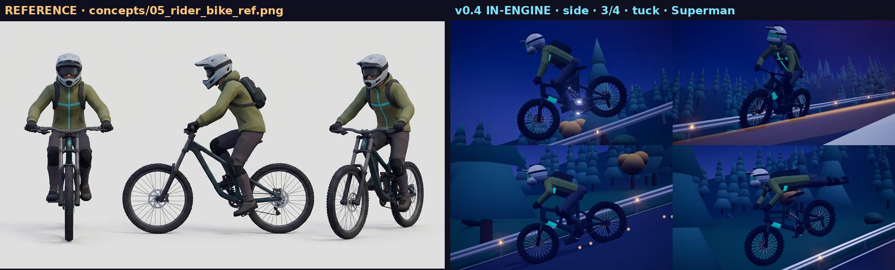

# The Mountain Drop

A modern-Japan low-poly downhill MTB game. Lean a full-face rider down night roads and switchbacks, link tricks into combos, drift the guardrails, and ride through rain, snow, fog, and sakura wind while music-reactive spirit chasers close in. A 20-trail hub opens the mountain one descent at a time, and a gear shop spends your bank on the bike that gets you further.

**[Play live](https://krishristov33-cloud.github.io/Mountain-Drop/)**

Prototype v0.6 is a single [`index.html`](index.html). It loads three.js from the unpkg and jsDelivr CDNs and has no build step. Use the live site, or serve this folder and open the file in Chrome or Edge.

## Controls

v0.6 ride controls, from [docs/NOTES.md](docs/NOTES.md). The same map is on the start screen and the pause menu.

| Key | Action |
| --- | --- |
| A / D | Steer and lean |
| W / S | Pedal (tuck when fast) / brake |
| Y / H | Front flip / back flip, in the air |
| Q / E | 360 spins, in the air |
| Space | Hop. Hold to charge, release to jump |
| Shift | Boost. Hold; a press on the beat is PERFECT |
| C | Drift, with steer |
| J / K | Tricks, with W / S / A / D |
| L | Manual. In the air, a wide rail catch |
| P / Esc | Pause |
| F1 | Help |

Arrow keys do the same as W A S D. On the trail hub, arrows or WASD move between trails, Enter or Space starts the ride, and G opens the gear shop.

## Screenshots

Cedar Pass in sakura wind.

The 20-trail hub.

A dusk switchback, with spirits on the road.

Rider and bike, reference sheet beside the in-engine poses.

Concept art lives in [`concepts/`](concepts/).

## Radio

The optional JSR Live radio streams from [jetsetradio.live](https://jetsetradio.live). It is a fan / private-test feature, and its music is © its owners. If a track will not play, the game falls back to its own synth.
